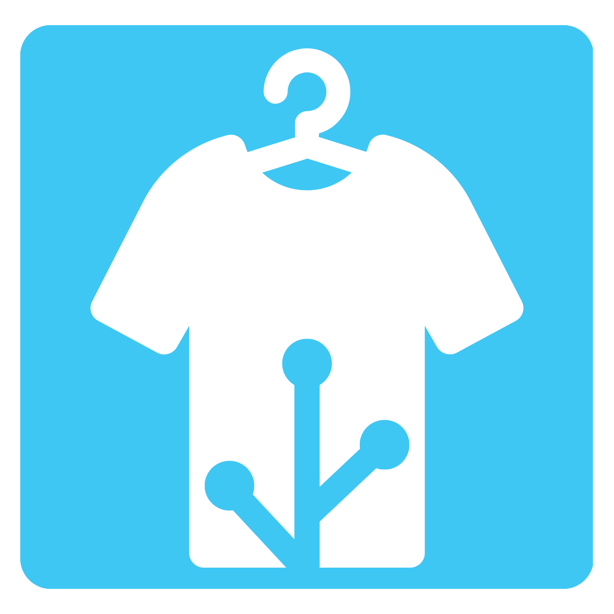
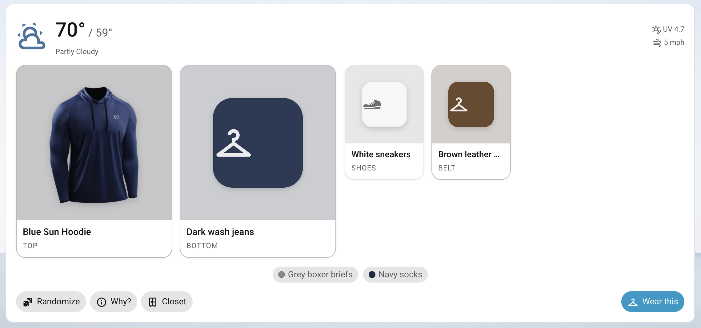
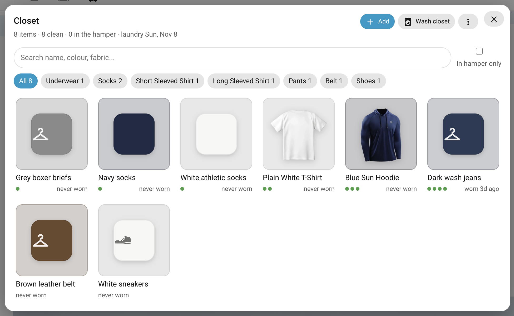

   
# Closet Assistant

*Your Home Assistant, now also your closet assistant.*

Closet Assistant is a custom Home Assistant integration (installed with HACS) that picks an outfit for the day from your actual closet. It does **not** use generative AI to do this. It uses rule-based scoring and weighted randomness built on the day's weather, warmth layering, and outfit design rules: proportion, the 60-30-10 colour split, and pattern mixing. It also tracks how many times each piece has been worn and resets everything on laundry day.

It ships with two dashboard cards:

| Card | Type |
|---|---|
| **Wear Today**: high/low, rain chance, UV and wind, today's outfit as a board of cards (top and bottom large, then layers, shoes and accessories), **shed later** badges on removable layers, **Randomize**, **Wear this**, **Why?** notes, and a **Closet** button that opens the Manage Closet card in a popup | `custom:closet-assistant-today-card` |
| **Manage Closet**: add, edit, remove items, upload images, cleanliness, **Wash closet**, an **Unworn** review list for decluttering, import/export JSON, scan the image folder | `custom:closet-assistant-closet-card` |

The cards are bundled inside the integration and load on every dashboard automatically, so that you don't need to add a separate Lovelace resource.

## Wear Today:


## Closet:


---

## Install

### HACS (custom repository)
1. In HACS, open **⋮ → Custom repositories**, add the repo URL, and pick the category **Integration**.
2. Install **Closet Assistant** and restart Home Assistant.
3. Go to **Settings → Devices & services → Add integration → Closet Assistant**.


### Setup wizard
| Setting | What it does |
|---|---|
| Weather entity | Any `weather.*` entity. The integration reads today's daily forecast through `weather.get_forecasts`: high, low, precipitation and chance, UV, wind. If the provider has no daily low, it falls back to the hourly forecast. |
| How dirty do your clothes get? | **1** = dirtiest (wear once between washes), **2** = average, **3** = cleanest (wear 3 times). |
| Laundry day(s), every N weeks, reset time | At that time on laundry days, every item goes back to clean. You can also manually reset clothes when washed. |
| New outfit each morning at | When the day's suggestion is generated. The default is 05:00. |
| Temperature sensitivity | −5 (run hot) to +5 (run cold). Each step shifts the targets by about 2 °F. |
| Layering threshold | If high minus low is at least this many degrees, the outfit is built in layers. |
| Suggest letting go after | Days unworn before an item is flagged in the closet's **Unworn** list. The default is 180. Seasonal pieces always get at least a year. 0 turns it off. |

You can change all of these later under **Configure**.

### Add the cards
```yaml
type: custom:closet-assistant-today-card
title: Wear Today        # optional
closet_button: true      # optional, set false to hide the Closet button
```
```yaml
type: custom:closet-assistant-closet-card
title: My Closet         # optional
```
Both cards also show up in the card picker.

---

## The three inputs

### 1. Weather
This comes from the weather entity you choose during setup. It refreshes every 30 minutes, and again whenever you press Randomize.

### 2. Closet JSON
Import a file from **Manage Closet → ⋮ → Import JSON**, or with the service:

```yaml
action: closet_assistant.import_closet
data:
  path: closet_assistant/closet.json   # relative to /config
  replace: false                        # merge, or replace everything
```

See `examples/closet.json` for a full starter closet. The item fields:

| Field | Values | Notes |
|---|---|---|
| `name` | text | |
| `category` | `Underwear`, `Socks`, `Short Sleeved Shirt`, `Long Sleeved Shirt`, `Sweater`, `Jacket`, `Coat`, `Shorts`, `Pants`, `Skirt`, `Belt`, `Shoes`, `Hat`, `Accessory` | Labels, keys (`short_sleeve_shirt`) and common words (`jeans`, `hoodie`, `tee`, `blazer`, `sneakers`) all work. |
| `warmth` | 1-10 |  |
| `waterproof` | 1-10 | |
| `form_fit` | 1-10 | 1 = loose/oversized, 10 = tight/fitted. `form_fitting` is accepted too. |
| `uv` | 1-10 | |
| `structure` | 1-10 (optional, default 5) | 1 = fluid/drapey (silk, fine knit), 10 = rigid/tailored (heavy denim, wool, leather). Drives the structured-vs-fluid rule. |
| `color` | hex, e.g. `#1f2a44` | The main colour. |
| `accent_colors` | list of hex | The other colours in a pattern, or trim. Used for the "anchor with a common colour" rule. |
| `pattern` | `solid`, `stripe`, `pinstripe`, `check`, `plaid`, `houndstooth`, `polka_dot`, `geometric`, `floral`, `paisley`, `abstract`, `animal`, `camo`, `graphic` | |
| `pattern_scale` | `micro`, `small`, `medium`, `large` | Each pattern has a default. |
| `fabric` | `cotton`, `denim`, `linen`, `wool`, `knit`, `fleece`, `silk`, `satin`, `leather`, `suede`, `corduroy`, `tweed`, `nylon`, `synthetic`, `other` | Optional. Used for texture variety in tonal outfits. |
| `image` | file name, `/local/...` path or URL | A bare file name is looked up in `config/closet_assistant/images/`. |
| `last_worn` | `YYYY-MM-DD` | |
| `wears_since_wash` (or `cleanliness`) | integer | `cleanliness` = wears left before the item needs washing. |
| `max_wears` | integer (optional) | Overrides the default wears between washes for that item. |

**Default wears between washes** = your setup level × a category multiplier. Shirts, shorts and skirts get ×1, sweaters and pants ×2, jackets ×4, and coats ×6. Underwear and socks are always 1. Belts, shoes, hats and accessories never go in the hamper.

### 3. Closet images
- Upload an image in the item editor. It's resized in the browser to 640 px and saved as WebP with its transparency kept. The item's main colour is **detected automatically** from the opaque pixels.
- Or drop images into `config/closet_assistant/images/` and use **⋮ → Scan image folder** (or the `closet_assistant.scan_images` action). This creates a draft item for every unused image, guessing the category from the file name (`jeans_dark-wash.png` becomes Pants). Drafts are marked **review**, so tap them to fill in the ratings.
- Square or portrait images with a transparent background look best on the cards.
- **How images are shown.** Photos with a transparent background float on a softly tinted card. Photos with a solid background (an ordinary snapshot) fill the card edge to edge instead. Items without a photo show a swatch in their color and pattern.

> Images are served from `/closet_assistant/images/` with random file names. Like `/local/`, that path does not require a login, so don't upload anything private.

---

## How an outfit is chosen

1. **Weather → warmth targets.** The torso target is `(88 − °F) / 3.5` warmth points: about 5 at 72 °F, 8 at 60 °F, 14 at 40 °F. Legs get `(85 − °F) / 5`. Wind (15 mph and up) and rain add a little. Your sensitivity setting shifts the temperature first.
2. **Layering.** If the high/low swing is at or above your threshold, the outfit's **full** warmth (top + sweater + jacket, plus half a scarf) must suit the **low**. The engine then tries shedding the jacket, the sweater, or both, and finds the combination that best suits the **high**. Pieces to shed are marked *shed later* on the card.
3. **A few hundred candidates.** It assembles random combinations of clean items: a top and a bottom always, then a sweater, outer layer, shoes, belt, hat or accessory, each with odds that depend on the weather.
4. **Scoring.** Each candidate is scored on:
   - **Warmth fit.** Being too cold costs more than being too warm.
   - **Rain.** When rain is likely, the outer layer needs waterproof ≥ 6, and shoes get a small check too.
   - **UV.** At UV 3 and up, what you wear at peak sun is checked for UV protection, and a hat is wanted at UV 6 and up.
   - **Volume and proportion (2/3 rule).** All-tight or all-loose outfits lose points. A fitted top with a loose bottom, or the reverse, scores best.
   - **Structured vs fluid.** It rewards mixing rigid and drapey pieces.
   - **60-30-10.** Colours are weighted by how much of you each piece covers, grouped by perceptual similarity (CIELAB), and compared to a 60/30/10 split.
   - **Tonal dressing.** A single colour family is fine *if* the fabrics or structures vary. Otherwise it reads as flat and loses points.
   - **Hue harmony.** Analogous, triadic and complementary combinations are rewarded. Neutrals (black, white, greys, navy, denim, khaki, tan, olive) go with everything. More than three bright colour families loses points.
   - **Pattern mixing.** Same-scale patterns and same-type patterns (two geometrics) lose points, and so do three or more patterns. A shared colour between patterns, or a solid neutral bridging them, rescues the mix.
   - **Belt matches shoes.**
   - **Rotation.** Items worn today or in the last couple of days lose points. Items not worn in two weeks get a bonus. Repeating a top+bottom combo from the past 14 days loses points.
5. **Weighted random pick.** It picks among the top 6 with softmax weights. **Randomize** also lightly avoids the pieces in the outfit you're replacing.

Value contrast (high vs low) is reported in the "Why this?" notes but not penalised, since both looks are valid.

## Wearing and washing
- **Wear this** marks every piece as worn today and uses up one wear. An item at 0 wears left goes to the *hamper* and isn't suggested again until it's washed.
- **Wash closet** (on the card, the button entity or `closet_assistant.wash_closet`) resets everything. Laundry day does this automatically.
- In the item editor: **Mark clean** washes one item, and **Wore it today** logs a single piece.

## Decluttering: "Haven't worn lately"
Every item records when it was added and when it was last worn. When something hasn't been worn for your threshold (6 months by default), the Manage Closet card shows a banner and an **Unworn** filter chip. Never-worn items count from the day they were added. Items that existed before this feature count from the day you updated.

The review list shows each piece, how long it's been unused and how often it's ever been worn, with two choices:
- **Keep** hides the item from the list for another full window. Wearing it also resets the clock.
- **Let go** removes it from your closet and deletes its photo.

**Seasonal pieces** get at least a year before they're flagged. That covers coats, shorts, anything with warmth 7 or above, and very light tees and skirts, so you aren't nagged about a parka in July. Flagged items also show an *unworn* tag in the main grid.

## Entities
| Entity | |
|---|---|
| `sensor.closet_assistant_outfit` | State: today's outfit. Attributes: `items`, `removable`, `notes`, `high`, `low`, `worn`, `layered`. |
| `sensor.closet_assistant_clean_items` | Count of clean items. Attributes: `in_hamper`, `total_items`, `last_wash`, `next_laundry`. |
| `sensor.closet_assistant_unworn_items` | Count of items flagged for decluttering. The `items` attribute lists each one with `unworn_days`. |
| `button.closet_assistant_randomize_outfit` / `_wear_outfit` / `_wash_closet` | For automations and other dashboards. |

Example automation, a morning notification:
```yaml
triggers:
  - trigger: time
    at: "06:30:00"
actions:
  - action: notify.mobile_app_phone
    data:
      title: "Wear today ({{ state_attr('sensor.closet_assistant_outfit','high') }}°/{{ state_attr('sensor.closet_assistant_outfit','low') }}°)"
      message: "{{ states('sensor.closet_assistant_outfit') }}"
```

A monthly declutter reminder:
```yaml
triggers:
  - trigger: time
    at: "10:00:00"
conditions:
  - "{{ now().day == 1 and states('sensor.closet_assistant_unworn_items') | int > 0 }}"
actions:
  - action: notify.mobile_app_phone
    data:
      title: "Closet check-in"
      message: >
        {{ states('sensor.closet_assistant_unworn_items') }} items haven't been worn in a while:
        {{ state_attr('sensor.closet_assistant_unworn_items', 'items') | map(attribute='name') | join(', ') }}
```

## Actions
`closet_assistant.randomize`, `wear_outfit` (optional `item_ids`), `wash_closet` (optional `item_ids`), `import_closet` (`path` or `data`, `replace`), `export_closet` (optional `path`, also returns JSON), `scan_images`.

## Data
Everything is stored in `config/.storage/closet_assistant.closet`, and images are in `config/closet_assistant/images/`. Both are included in normal HA backups.

# Upcoming Features

I am working on this as I have time, but if you have additional ideas, please let me know and I'll do my best to add them, or create a fork! 

# Features in progress:
- Favorite Outfits
- "Wear Tomorrow"
- Improving outfit picking system
